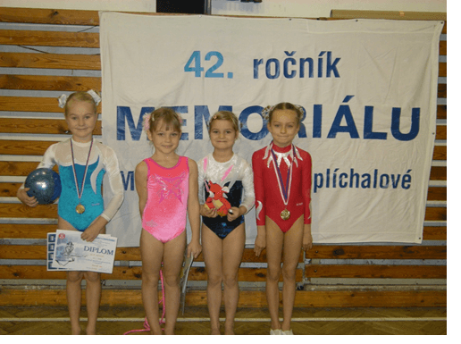

14.12. pořádal oddíl Sportovní gymnastiky TJ Sokol Chrudim ve sportovní hale dva tradiční závody ve sportovní gymnastice žen.

Již **42.ročník Memoriálu Mirky Brdíčkové-Šplíchalové** bývalé reprezentantky a olympioničky. Závodí se ve dvojboji, ve kterém vynikala, na přeskoku a bradlech.  
V kategorii žen vybojovala naše nynější nejúspěšnější závodnice 15-letá **Jana Novotná třetí místo** v těžké konkurenci děvčat z Kolína, Pardubic, Hradce Králové, atd.**.** Věnuje se tomuto krásnému a těžkému sportu již od svých 6 let a nyní to umí výborně zúročit.  
V mladších žákyních cvičila naše 8-letá závodnice **Kateřina Doležalová**, které se zdařil pěkný přemet přes bednu a hlavně zacvičila poprvé obtížnou sestavu na bradlech se vzklopkami. I když patřila k nejmladším, tak získala **skvělé 2.místo**. O rok starší **Barbora Tichá** se umístila na pěkném **5.místě** a **Markéta Doležalová byla na 7.místě**.  
Napjetí vládlo při vyhlašování výsledků **družstev**, nakonec se nejvíce radovaly **gymnastky TJ Sokola Bedřichov. Na druhém místě se umístily závodnice TJ Loko Pardubice a bronzový pohár získala naše děvčata ve složení Novotná – Doležalová K.**  
Ihned po tomto závodě začal další, a to **Župní vzpomínkový závod Lídy Pejchové pro nejmladší žákyně**. Členové chrudimského gymnastického oddílu ho pořádají na počest neúnavné trenérky a cvičitelky TJ Sokola Chrast.  
Závodilo se ve třech kategoriích. Děvčátka narozená v roce 2001 se snažila co nejlépe předvést to, co se naučila na třech nářadích: přeskoku přes bedýnku, bradlech a nízké kladince. Chrudimská gymnastka **Anitka Mašíková** všechno skvěle zvládla téměř bez chybiček a ke spokojenosti své trenérky Simony Hovorkové a samozřejmě rodičů se umístila na krásném **prvním místě.** Naše druhá malá závodnice **Barunka Štěrbová** bohužel spadla z kladinky a skončila na **pěkném 6.místě**.  
V kategorii ročníku narození 2002 jsme měli také dvě želízka v ohni. Výborně zacvičila**Zuzanka Malinská** a díky své obtížné sestavě na kladině **získala zlatou medaili**. Na krásném**4.místě se umístila Terezka Blehová**.  
Všechny děti, které přijely z několika krajů, si odnesly nějakou cenu a již se těší na vánoce a samozřejmě na další závody.

