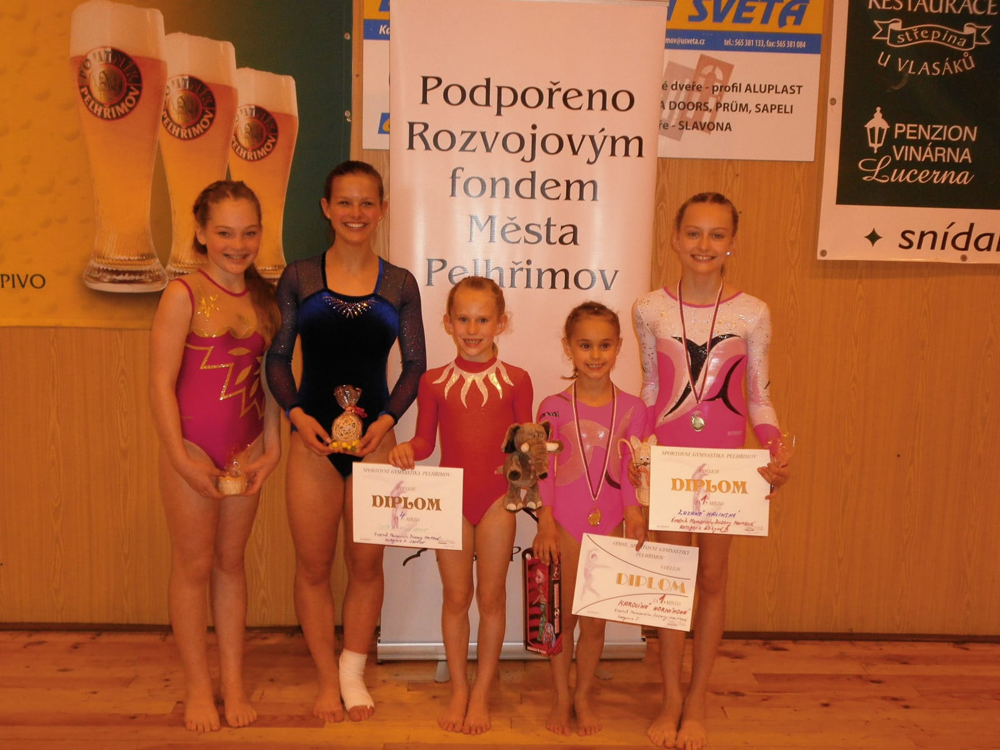

V sobotu 11.5.2013 se rozjelo 5 sportovních gymnastek T.J. Sokola Chrudim na 5.ročník Memoriálu Zuzany Hartlové, dlouholeté trenérky oddílu sportovní gymnastiky v Pelhřimově.

Nejmladší začínající žákyňky narozené v roce 2006-7 zahajovaly dvojbojem na lavičce a akrobacii. Za Chrudim závodila **Karolínka Horníková**, která měla jedny z nejtěžších sestav. Zacvičila je skvěle a to ji vyneslo až na nejvyšší stupínek, kde dostala na krk **cennou zlatou medaili** z celkového velkého počtu 36 závodnic.

V mladších žákyních ročník 2004-5 jsme měly **Sáru Kulhavou,** která zacvičila nejlepší sestavu na akrobacii ze všech 21 závodnic. Poprvé skočila přemet vpřed přes bednu, ale na kladině měla bohužel pád a tak jí jen o 0,07 bodu utekla bronzová medaile, **skončila na 4.příčce**.

V kategorii žákyň B 2001-3 závodily dvě chrudimačky. Nejlépe ze všech si vedla **Zuzanka Malinská**, která prošla trojboj přeskok, kladinu a akrobacii bez zakolísání. Zvládla i svůj první skok s obratem na přeskoku, což ji zajistilo nejvyšší známku. V těžké konkurenci závodnic z Pardubic, Slovanu Praha, Sokola Brno, atd. zaslouženě vybojovala **nádhernou zlatou medaili**.15. místo obsadila druhá naše **Bára Štěrbová.**

V nejstarší kategorii juniorek B závodila za Chrudim **Kateřina Doležalová**. Začínala přeskokem, kde si bohužel udělala lehký výron, ale zatnula zuby a sestavu na kladině a prostných zdařile dokončila. V těžké konkurenci se umístila na **9.místě.**

Nyní děvčata čeká krajský přebor ve Vrchlabí, kde budou bojovat o postup na MČR, tak jim držte pěsti.

