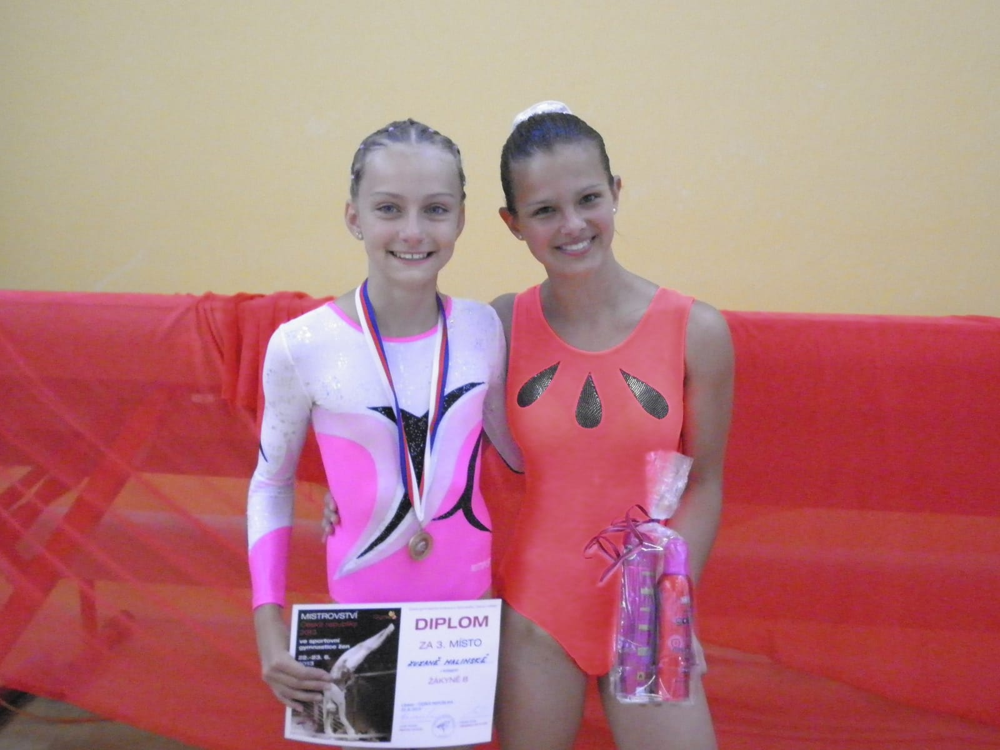
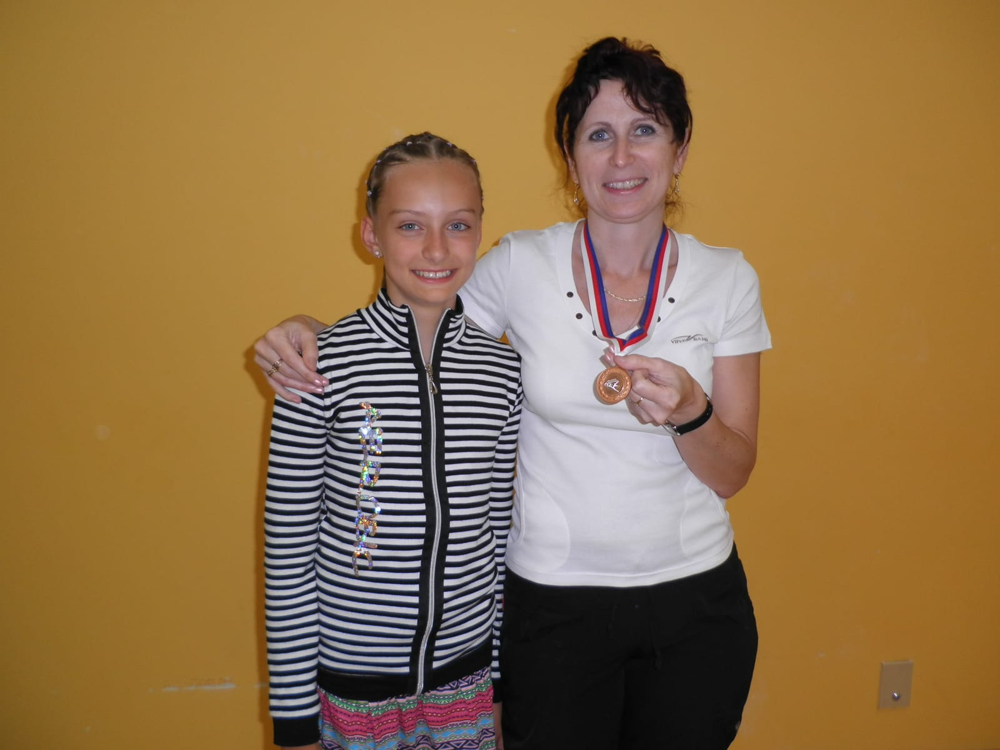

**22.-23.6.2013 Liberec**

Letošní MČR jednotlivkyň ve sportovní gymnastice se konalo v Liberci. Ikdyž byla velká vedra, sjeli se tam všichni, kteří mají rádi tento sport. Z oddílu SG T.J. Sokol Chrudim naše město jely reprezentovat dvě závodnice.

Do kategorie starších žákyň B bylo pozváno 34 nejlepších z celé republiky ve věku 10-12 let, které musely postoupit z krajských přeborů. **Naše 11-letá Zuzanka Malinská** si potřetí vybojovala postup na mistrovství, ale poprvé závodila za starší žákyně B. Přeskok s obratem měla výborný s třetí nejvyšší známkou. Z bradel seskakuje saltem prohnutě, což dobře ustála a hlavně na kladině zacvičila svou obtížnou sestavu s přemetem vzad a dálkovým skokem s výměnou nohou bez pádu se čtvrtou nejvyšší známkou a to bylo velice důležité pro celkové skóre. Prostná na novou hudbu s novou akrobatickou řadou přemet vpřed a salto vpřed se rozhodčím také velmi líbila. Závod se Zuzce velmi vydařil a tak jsme byly napnuté, jaký bude výsledek**. Při vyhlašování třetího místa vyhrkly Zuzance slzy štěstí, protože uslyšela svoje jméno. Dlouho tomu nechtěla věřit, než ji dali na krk bronzovou medaili !!!.** I pro mně jako trenérku to bylo úžasné překvapení a radostné, protože medaili z Mistrovství České Republiky jednotlivkyň naposledy získala mistrně republiky Veronika Bočková v roce 1993 a 1994. Takže je to pro mně a oddíl velká sláva po 19 letech. Je to samozřejmě velmi motivující i zavazující k dalším lepším výsledkům.

Do kategorie juniorek B se poprvé probojovala chrudimská krajská přebornice **13-letá Kateřina Doležalová**a i ta zacvičila bez pádu všechny svoje obtížné sestavy po vzoru své mladší kolegyně. Celkově si mezi o dvaroky staršími soupeřkami **vybojovala skvělé 16.místo!** Nejlepší umístění v této obtížné kategorii získala v roce 2003 Markéta Pecinová, která byla na 5.místě, tak snad se to Katce za rok také podaří.

Tímto vrcholným závodem naše chrudimské sportovní gymnastky završily závodní sezónu, která byla abnormálně úspěšná a již v srpnu se začnou připravovat na podzimní ligové soutěže družstev. Za snahu a píli v trénincích jim velmi děkuji, trenérka Simona Hovorková.

