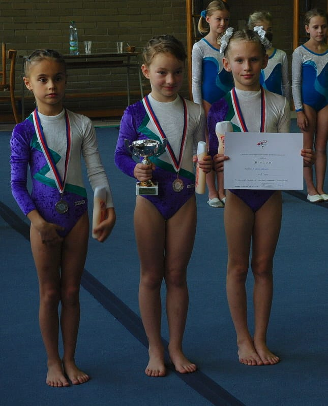

**Všechna chrudimská děvčata mají medaili.**

16.11.2013 se konal přebor družstev pardubického a hradeckého kraje ve sportovní gymnastice žen v Hradci Králové. Pět závodnic T.J.Sokola Chrudim reprezentovalo náš oddíl.

V družstvu II.ligy TJ Sokola Hradce Králové hostovala naše **Katka Doležalová i Zuzana Malinská. V soutěži družstev vyhrály a dostaly zlaté medaile**,v jednotlivkyních byla nejlepší **K.Doležalová**, která neudělala žádnou chybu, což ji vyneslo na **první místo**. Na **bronzovém stupínku** skončila další naše **Z. Malinská**. Mistrovství ČR v II.lize družstev se koná letos v Brně 1.12.

Chrudimské malé 7-8 leté žákyně tvořily také družstvo. Nejlépe si vedla **Sára Kulhavá**, která povinné sestavy zvládla skvěle a umístila se **druhá** v jednotlivkyních. Mladší **Karolína Horníková** zacvičila vše také výborně a skončila **na čtvrté příčce**, hned za ní byla **pátá Bára Šimonová.** Děčata společně jako družstvo získala výborné **stříbrné medaile**, těsně za prvním družstvem z Vysokého Mýta, třetí skončilo družstvo Loko Pardubice. Všechny splnily svoji třídu a příště mohou cvičit ve vyšší.

