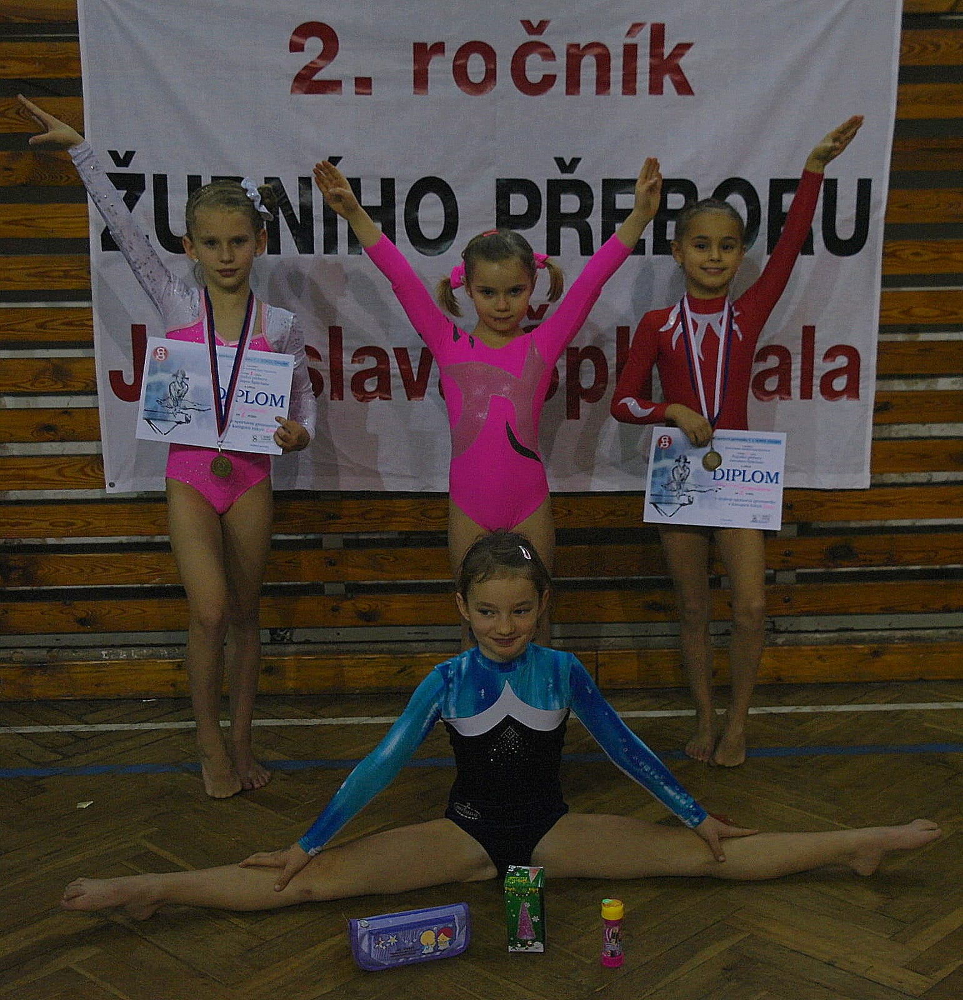

**Chrudimačky vyhrály zlatý pohár.**

15.12.2013 pořádal oddíl Sportovní gymnastiky T.J. Sokol Chrudim ve sportovní hale tradiční závod ve sportovní gymnastice žen. Bohužel se tento závod konal ve smutném duchu, protože 22.9.2011 tragicky zahynul jeho zakladatel Jaroslav Šplíchal, bratr Mirky Brdíčkové-Šplíchalové bývalé reprezentantky a olympioničky. On sám byl také vynikající sportovec, atlet, lyžař a zakladatel oddílu gymnastiky v Chrudimi, **letos slavíme 60 let od jehovzniku**. Rozhodli jsme se v jeho úžasné práci pokračovat dál.

Memoriál je dvojboj ve cvičení na přeskoku a bradlech, zúčastnilo se ho 8 jednot. V kategorii juniorek poprvé cvičila naše 13-letá **Kateřina Doležalová**, která výborně skočila přemet s obratem přes přeskokový stůl a povedla se jí obtížná sestava na bradlech a tím si zajistila celkové **vítězství**.

Za starší žákyně skvěle závodila naše úspěšná závodnice **Zuzana Malinská bronzová z Mistrovství ČR,** která také skočila nejlépe přemet s obratem na přeskoku a proto získala také **zlatou medaili**.

**Obě naše zlatá děvčata zvítězila i jako družstvo a získala pohár**. Na druhém místě byla děvčata z Lokomotiva Pardubice a bronzový pohár získala děvčata ze Sokola Hradec Králové.

Ihned po ukončení tohoto memoriálu byl zahájen **2. ročník župníhopřeboru na počest Jaroslava Šplíchala** pro nejmladší závodnice v trojboji přeskok, bradla a nízká kladina.

V kategorii ročník 2005 bylo 12 šikovných děvčat. Chrudimská **Sára Kulhavá** bohužel dvakrát spadla z bradel a proto přišla o celkové vítězství, umístila se **na třetí příčce. Bára Šimonová skončila na pátém místě**.

Dvě malé chrudimské gymnastky závodily v kategorii 2006 a sklidily úspěch. **Karolína Horníková získala zaslouženě stříbrnou medailí** a nováček našeho oddílu **Lada Schillerová byla na velmi pěkném 4.místě.**

Myslím, že naše děvčata dobře reprezentovala náš oddíl T.J.Sokol Chrudim a Jarda Šplíchal by z nás měl radost .
