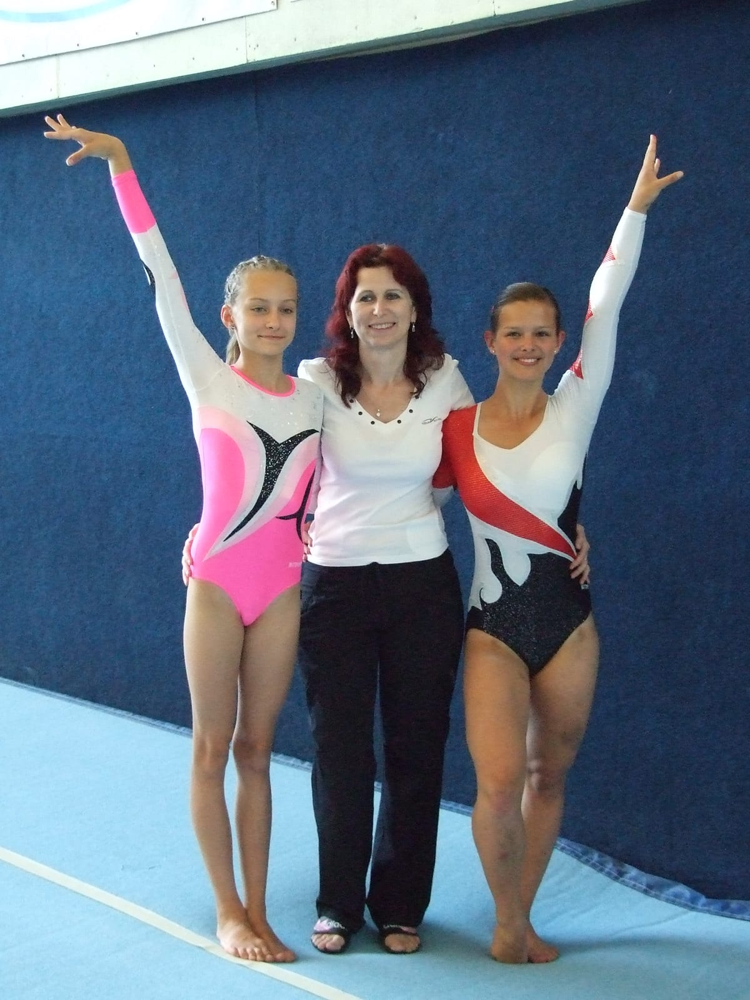

**7.-8.6. 2014 Brno**

Letošní MČR jednotlivkyň ve sportovní gymnastice se konalo v tělocvičně Sokola Brno I. Ikdyž byla velká vedra, sjeli se tam všichni, kteří mají rádi tento sport. Z oddílu SG T.J. Sokol Chrudim naše město jely reprezentovat dvě závodnice.

Do kategorie starších žákyň B bylo pozváno o 10 závodnic více než loni celkem 44 z celé republiky ve věku 9-12 let, které musely postoupit z krajských přeborů. **Naše 12-letá Zuzanka Malinská** si počtvrté vybojovala postup na mistrovství. Na bradlech zařadila nový náskok s obratem 360stupňů a získala 5-tou nejvyšší známku. Na kladině měla také nový obtížný prvek rychlý přemet vzad, ale ten ji bohužel nevyšel a spadla. Zato se jí vydařil další nový prvek prohnuté salto vpřed na prostných, kde měla líbivou sestavu. Po loňské úžasné bronzové medaili jsme tušili, že díky bodové ztrátě z kladiny to asi nevyjde. Při vyhlašování **vystoupila Zuzka na krásné 9. místo a obdržela diplom a cenu.** Za rok již postupuje do starší kategorie juniorek, kde za náš oddílpodruhé závodila krajská přebornice **14-letá Kateřina Doležalová.** Jí se vydařil pěkně přemet s obratem na přeskoku. Bradla měla skvělá, získala 6-tou nejvyšší známku, protože zařadila nový obtížný a hodnotný seskok salto prohnutě s jedním obratem. Na kladině zařadila poprvé rychlý přemet vzad, ale také bohužel s pádem, což byla škoda, **odsunulo ji to z celkové 8.příčky nakonečné 11.místo ze 30 závodnic** z velkých oddílů. I to je pro Katku zatím nejlepší umístění v juniorkách, po 6.místě ve starších žákyních.

Tímto vrcholným závodem naše chrudimské sportovní gymnastky završily závodní sezónu, ve které získaly mnoho medailí a krajských titulů. Již v srpnu se začnou připravovat na podzimní ligové soutěže družstev. Za snahu a píli v trénincích jim velmi děkuji, trenérka Simona Linková

