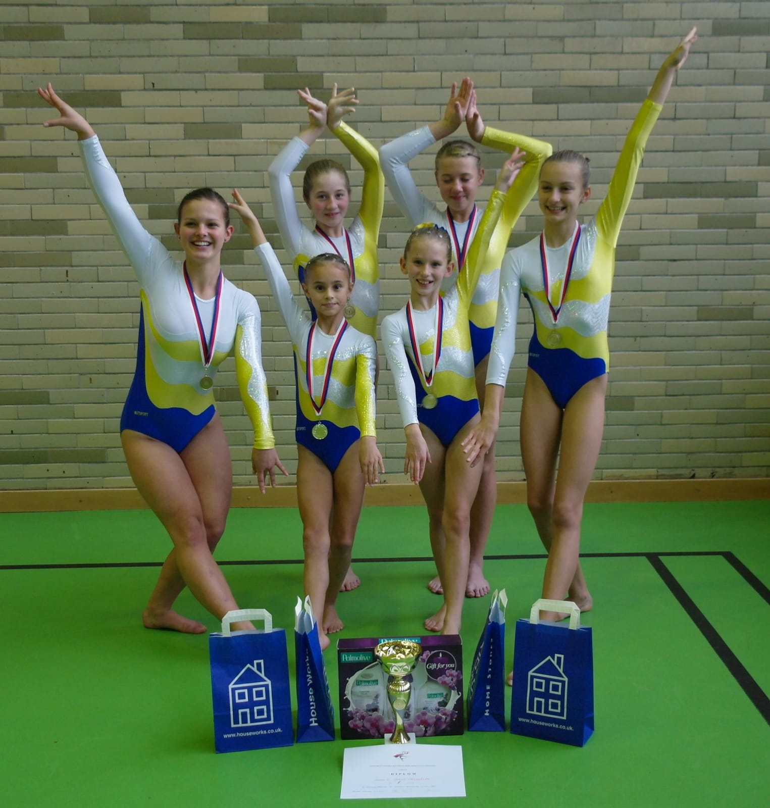

**Všechna chrudimská děvčata mají medaili.**

22.11.2014 se konal přebor družstev pardubického a hradeckého kraje ve sportovní gymnastice žen v Hradci Králové. Pět závodnic T.J.Sokola Chrudim reprezentovalo náš oddíl.

Naše tři nejlepší děvčata vytvořila družstvo II.ligy a jako hostující za Chrudim závodily dvě gymnastky ze Sokola Hradec Králové. Byl to boj o jedno postupové místo na MČR s družstvem Lokomotivy Pardubice. Naše závodnice se skvěle připravily a zvládly všechny své obtížné sestavy bez velkých chyb. Při vyhlašování jsme byly napjaté, ale nakonec **naše družstvo o dva body zvítězilo a získaly cenné zlaté medaile**,V jednotlivkyních byla nejlepší naše **Kateřina Doležalová**, která zaslouženě zvítězila. Takže **družstvo ve složení K. Doležalová, Z. Malinská, S. Kulhavá a hostující K. Klausová, A. Dorreová bude reprezentovat Chrudim na Mistrovství ČR v II.lize družstev**, které se koná letos v Brně 6.12.

Malá **Karolína Horníková** hostovala v družstvu Loko Pardubice ve III.lize a také si odvezla na krku **zlatou medili** a **Bára Šimonová** závodila také výborně v mladších žákyních za oddíl SokolPardubice a **dostala stříbrnou medaili.**.

