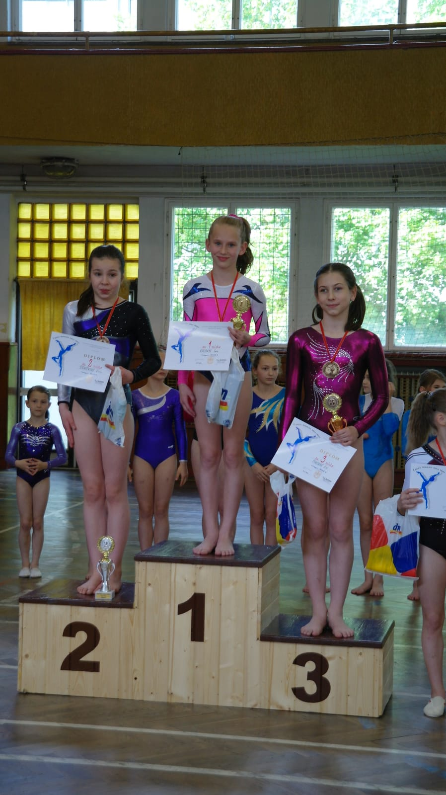

**Sára suverénně vyhrála.**

Dvě sportovní gymnastky TJ Sokola Chrudim se vydaly do Jindřichova Hradce na 1.ročník Memoriálu Karla Parmy vedoucího celého oddílu, který měl pracovní úraz s tragickými následky.

Obě děvčata cvičila v kategorii žákyně B, kde závodilo celkem 25 gymnastek. Naší **Sáře Kulhavé** se vydařila výborná sestava na kladině, za kterou měla nejvyšší známku a skočila moc dobře skok s obraty na přeskoku. Při vyhlášení jsme byly příjemně překvapené, že se jí podařilo porazit dvě o rok starší závodnice z Loko Pardubice a vyskočila na nejvyšší stupínek **pro zlatou medaili.**

O rok mladší **Karolína Horníková** závodila poprvé v této kategorii a nebýt pádu z kladiny, tak by získala bronz. Měla novou sestavu na prostných a skákala poprvé obratový přemet na přeskoku. Celkově se umístila **na krásném 8.místě**.

Byla to zkouška před oblastním přeborem, který se bude konat 28.5. ve Vrchlabí. Držme palce děvčatům, ať se jím vše vydaří ještě lépe a postoupí na Mistrovství České republiky.

