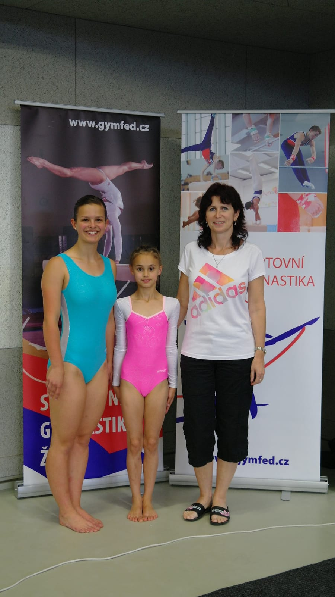

**19.6.2016 Třinec**

Mistrovství ČR jednotlivkyň ve sportovní gymnastice letos uspořádal oddíl v dalekém Třinci. Z oddílu SG T.J. Sokol Chrudim naše město jely reprezentovat dvě závodnice, i když postoupily čtyři z krajského přeboru. Naše želízko v ohni byla Sára Kulhavá, která loni měla málem bronz v kategorii žákyň, ale pár dní před mistrovstvím si poranila kotník a naše skvělá juniorka Zuzana Malinská doléčuje zlomený palec u nohy. Takže i za své kamarádky jela bojovat naše nejlepší **žena Katka Doležalová a s ní nováček malá 10-letá Kája Horníková.**

V kategorii žen byla obrovská konkurence z oddílů Bohemians Praha, Moravská Ostrava, SG Liberec a děvčata podávala skvělé výkony např. s dvojnými salty, vruty a veletoči. **Naše 16-letá Kateřina Doležalová**, závodila za ženy poprvé. Všem se líbila její krásná sestava na prostných a povedla se jí i bradla. Bohužel pád z kladiny ji odsunul ze sedmého na i tak **skvělé 10.místo**, za to jí patří dík a uznání.

V kategorii žákyň B se poprvé zúčastnila Mistrovství republiky naše **talentovaná 10-letá Karolína Horníková**, patřila mezi pět nejmladších závodnic, bylo pozváno 44 nejlepších z celé republiky ve věku 9-12 let. Kája zahájila závod nádherným přeskokem s obratem, za který dostala nejvíce bodů ze všech. Na bradlech zariskovala a předvedla velmi obtížný letový prvek, což jí vyneslo skvělou pátou známku. Na kladině se žádná tréma také neprojevila, zvládla sestavu bez pádu i s obtížným rychlým přemetem vzad a na prostných zacvičila pěknou sestavu se salty na novou hudbu. Karolínka se předvedla jako skvělá závodnice a zraněnou Sáru výborně zastoupila. Při vyhlašování jsme měli všichni **obrovskou radost z nádherného 5.místa** !!!. Je to pro náš malý oddíl velký úspěch. Stejně jako loni nám unikla bronzová medaile jen o pár desetin bodu, tak příště už to určitě vyjde, je to pro všechny velká motivace do další přípravy.

Tímto vrcholným závodem naše chrudimské sportovní gymnastky završily svoji skvělou závodní sezónu a již v srpnu se začnou připravovat na podzimní Mistrovství ČR družstev v II.lize. Za snahua píli v trénincích jim velmi děkuji a přeji krásné prázdniny, trenérka Simona Linková.
